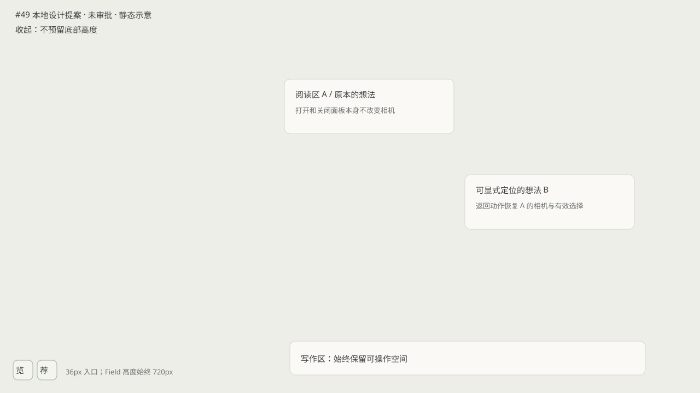
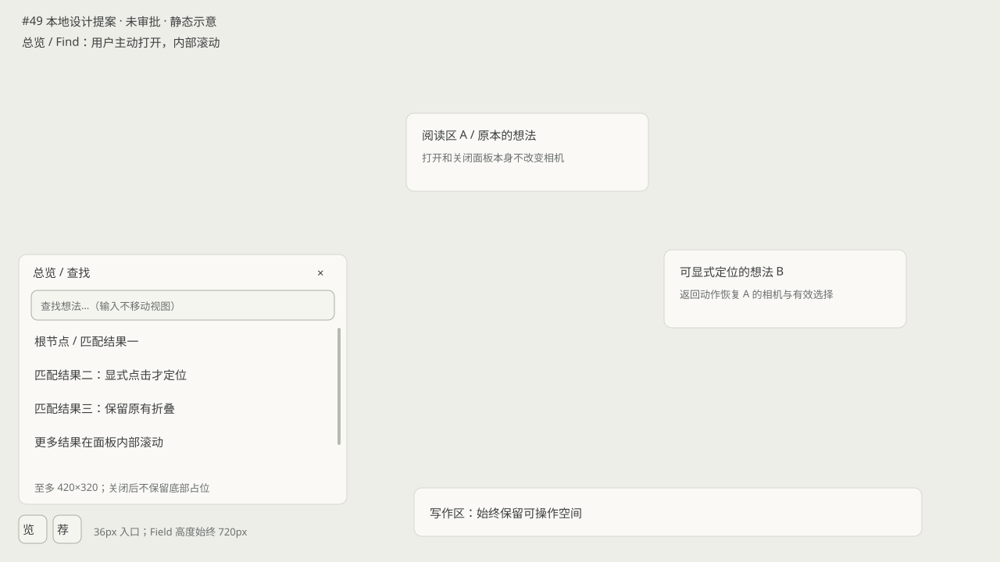
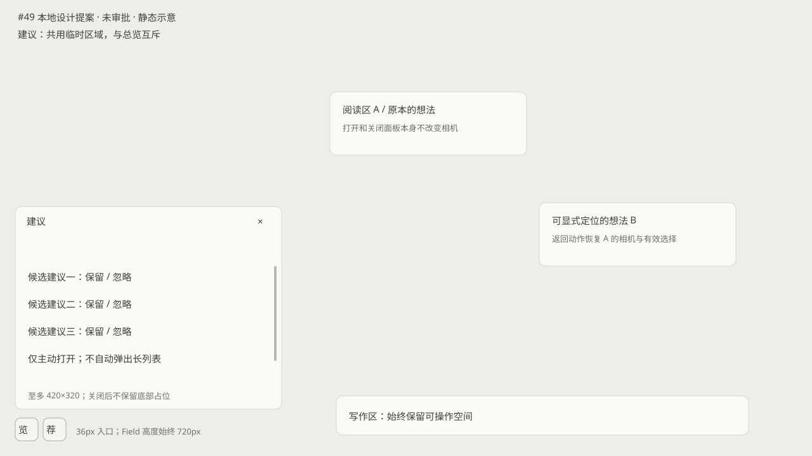

# #49 导航交互提案与共享规则确认

2026-10-13。#48 紧凑阅读方向已获产品批准；本次对照 #65 `94db15aa6b4c670955964fb53e447660f991b4be` 确认共享位置、互斥、写作安全区、焦点/Escape/IME 与普通关闭边界。下文的 #49 单返回点导航仍是提案，未获批准或写入生产代码。依据：[共享清单](https://github.com/NekoMint-Labs/Diffusion/issues/49#issuecomment-6120055622)、[#48 批准](https://github.com/NekoMint-Labs/Diffusion/issues/48#issuecomment-6125616799)。

## 返回点与动作

在第一次显式点击匹配项或非输入法组合态 Enter、调用 reveal 之前，记录当前 Field 的相机 x/y/zoom 和选择 IDs 为 A。打开面板、输入查询、筛选和零匹配均不记录或移动视图。当前会话内继续定位 B/C 共用 A，不建立历史栈。面板开关、查询文字变化不覆盖 A；已有返回点时，再次打开也继续保留。只有显式返回、切换 Field 或重载才结束该返回点生命周期。这一规则替换 v2 中含糊的“新查询会话替换返回点”。

| 动作 | 面板/焦点 | 相机/选择/AI 请求 |
| --- | --- | --- |
| 关闭或再次点总览入口 | 收起，焦点回有效入口 | 留在当前目标；不恢复 A，不取消请求 |
| 非合成态 Escape | 与关闭相同 | 留在当前目标；不恢复 A，不取消请求 |
| 合成态 Escape/Enter | 交给输入法 | 不关闭，不定位，不取消请求 |
| 切到建议 | 总览收起，共用区域打开建议 | 不恢复 A，不改变选区，不取消请求；保留返回点 |
| 进入写作 | 收起面板，焦点留在写作区，保留草稿 | 不恢复 A，不改变已有返回点，不取消请求 |
| 显式“返回刚才视图” | 收起面板，焦点回 Field | 恢复 A 的相机及仍存在的选区，清除返回点；不取消请求 |

普通收起不能直接复用带相机恢复/请求取消副作用的 useWorkspaceSurfaces.closeSurface()。正式实现复用 CameraController/FieldHandle 的 reveal/restore 接口，单独维护这个临时面板的开关，不新增第二套相机系统。

## 删除、折叠与空结果

- 无匹配时显示空结果说明，不调用 reveal，不改变相机/选择；查询仍可编辑。
- 显式定位前再次确认目标存在。目标已删除则更新列表并说明不可定位；不移动视图，焦点留查询框。
- 返回时过滤已删除的选择 ID；都不存在则恢复空选区。相机恢复到记录位置，仍应用已有相机合法值边界。
- 不恢复历史折叠快照，不改变当前显式层级折叠。折叠内目标标注所在分支，用户显式选择后定位其可见祖先，不自动展开层级。现有 FieldHandle.reveal 不负责解析可见祖先，正式实现需先用当前层级投影解析目标，再调用 reveal；不可把它误当作现成的祖先定位接口。
- 可见入口已消失时焦点依次回总览入口、仍有效的原 Field 焦点目标。进入写作不抢回入口焦点。返回点即使目标删除也仍可恢复原视图。

## 共享位置与尺寸

左下角总览/建议两个 36px 高入口，无通栏占位。最多一个临时面板，宽度不超过 420px，且不超过 viewport 减两侧 margin（与 #65 一致，margin=min(24px, viewport/8)），高度最多 320px，并受写作安全区以上实际空间限制；内部滚动，必要操作保持可达。1280×720 采用 420×320 上限。小窗口和逻辑缩放后重新测量屏幕空间，不缩放正式卡片或改相机来容纳面板。安全空间不足时收起临时面板，保持入口与写作可用，不自动搬动 Field 内容。

共享六项规则：位置共用、面板互斥、写作安全区优先、焦点与 IME/Escape 分离、保留来源身份和空间、普通关闭与显式返回分开。B 的 Keep 阅读回执结束不等同 C 的导航返回；C 不接管候选批准、忽略或 AI 请求。

## 后续验收

批准后在真实组件记录 A→B→C→返回 A 的精确相机、缩放、选择；关闭/Escape/切换建议/写作均保持当前位置及请求；零匹配、目标删除、选区部分删除、折叠、重复打开、Field 切换和重载分别验证。浏览器合成 IME 事件和逻辑缩放，与 Windows 物理输入法/DPI 分别记录。

本补充仍需 @onedotmint 确认可见行为，尤其单返回点生命周期。原型只有示例 A/B，不冒称已实现全部生产契约。本轮按操作者要求提交至 GitHub，请 @onedotmint 确认 #49 的上述导航行为；#48 的既有批准不自动批准本提案。

## 1280×720 静态示意

以下为先前本地设计草图，仅说明空间安排；交互文字以本文为准，不是生产截图或完成验收的证据。

