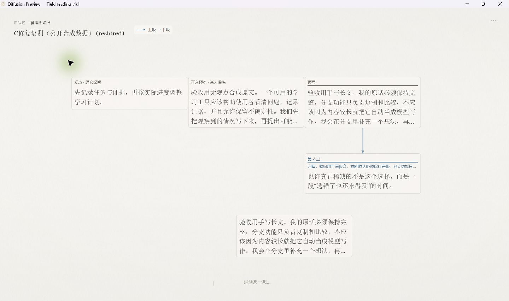

# Bring 避让修复与 Windows 复测

2026-10-28 至 29 日，本机已安装并操作修复版 Tauri / WebView2 桌面程序。原 N01“分支带回的新卡覆盖已留下的建议卡”在本轮场景中已修复；关闭重开与原生 JSON 恢复后，全文和新位置均保留。

本记录只判定下列已测路径通过。真实模型质量、A/B 正式复审及候选冻结仍未完成，不据此宣称完整版本放行。

## 固定来源

- 修复：[PR #88](https://github.com/NekoMint-Labs/Diffusion/pull/88)，目标为 #83；产品源码 `5e4f979c5c210246577280ac91fd58d2631d8920`，tree `b3e00cc943edbdb0610a285ab510a21ca4febd61`。
- Windows x64 NSIS，版本 0.3.16，未签名；应用标识仍为 `app.diffusion.explorer.preview`，路由仍为 `index.html?locale=zh&readingTrial=1&propositionTrial=1`。
- 安装器 15,407,319 字节，SHA-256 `52c77ea9437dc4c200500aa22885217d437c585450cd4705c4660477d675c372`。
- 裸构建程序 SHA-256 `651dd372cdd16f0c335efc9c35a65de7e518c891dd7a204814efd96c676f5383`；实际安装程序 `246f1d6ac40ed79faec73cd22040c0722c8c57fc3a0843eec2501747815fb620`。仅归一化 Tauri 的 NSIS 类型标记后，两者字节哈希完全相同。
- 新 Vite 主包 `index-m-C7LP2v.js` 已列入真实 Rust 编译依赖，主包 SHA-256 `57b05ee01619345c0196e0211aeed5956bfec55af839c3841b173d4d29d52395`；不是仅凭 exe 文件名判断更新。
- 784 个跟踪文件构建前后哈希一致，1,010 项安装资源逐项匹配。固定 Preview 原位更新，桌面保持一个快捷方式。
- 更新前最新 Preview 数据共 330 个文件已备份并逐项校验；安装结束、启动复测之前，这 330 个原文件均未改变。复测本身会正常保存新测试项目，不能将更新前哈希结论延伸到复测后的整个资料目录。

## 修复行为

原实现直接按视口点和固定网格落下新卡，没有检查主线占位。现在由空间层选择新卡坐标，Core 继续通过原用户事件添加独立卡片。每张新卡都检查最新 Main，包括同批已经带回的卡片；优先保留可用原点，再就近寻找空位，密集情况下使用已占区域右边缘之外的兜底位置。

占位考虑 Thought / Crystal / Source 的宽度、语义缩放、当前正文字号，以及短原文和合法观点的完整行数。不会自动重排已保存的卡片，也不修改旧正文、相机、关系、来源或去重规则。预挂载占位是保守估算；不是任意字体和布局组合下实际 DOM 尺寸的完整证明。

## 自动检查

固定产品提交 `5e4f979`：应用类型检查通过；offline 332/332（新增 Bring 回归 10 项），无失败或跳过；Vitest 82 文件、769/769；构建通过。三个最终检查执行前后，五个修复输入文件哈希一致。远端八项检查均成功：[CI](https://github.com/NekoMint-Labs/Diffusion/actions/runs/40719337291)、[交互 E2E](https://github.com/NekoMint-Labs/Diffusion/actions/runs/40719337277)、[原生参数验证](https://github.com/NekoMint-Labs/Diffusion/actions/runs/40719337311)。

首次完整 Vitest 曾有一项 ingestion 动态导入后的计时等待失败（768/769）。原始失败保留；随后该文件隔离 8/8 通过，最终在无其他本机构建并发时完整复跑一次，769/769 通过。未改断言、超时或重试；尚未确定首次失败的唯一原因，不用后续成功抹去它。

低缩放（0.08 / 0.4）、24px 多换行短原文、密集兜底与混合类型批量避让由离线回归覆盖；未将这些离线场景写成全部已做实机覆盖。

## 原生实测

使用 [公开初始项目](public-fixture.json)：三张公开合成长卡，加一张来自上轮 Demo 的已留下建议；不是用户私人内容，也不代表真实模型质量。主题为编辑暖纸，界面尺寸 100%，未改变系统缩放或正文字号。

| 路径 | 本轮实测 |
| --- | --- |
| Fork → 编辑 → 比较 → Bring → 主线 | 手写卡追加“ 修复复测：分支长文带回，正文完整。”后带回；新卡避开已留下的 Demo 卡；旧四卡逐项 JSON 比较完全一致 |
| 实际布局 | Bring 时窗口捕获 1440×852；新卡 x=545.808554890562、y=510.61520051970285；Demo 卡仍为 740/337，相机仍为 122.66666412353516/74.82696266069661/1；截图中两卡分开可读 |
| 关闭重开与原生导出恢复 | 5 张正式卡片、5 段全文和新布局保留；恢复创建独立项目；新带回卡为 228 字，逐字等于原手写文加追加句，没有 generatedBy |
| 结晶与 Undo/Redo | 有合法观点的 AI 卡经明确确认成为 Crystal，旧观点失效；Ctrl+Z 恢复观点，Ctrl+Shift+Z 再次失效；最终导出为 crystal，218 字原文未变，proposition 已移除 |
| 未留下建议 | 实际调用 Demo 生成一条问题；UI 明确显示待处理建议，未点留下。随后导出仍只有 5 张正式卡，问题不在其中；关闭重开后该临时建议消失，5 段正式全文仍在 |
| 底部提问框真实 IME | 系统 n/h 候选窗口真实出现；候选态 Enter 保留草稿并未发送，Escape 只取消候选并保留输入框与已有 n 草稿；待处理建议数量仍为 1 |

此处 IME 使用系统输入注入，不是网页合成 composition 事件；没有操作者物理键盘、触摸板或操作系统重启证据。服务仍是“示例 / 未使用真实模型”，真实模型请求数为 0。

以下 1440×852 原生测试截图已于 2026-10-29 获用户明确授权公开，只包含本轮公开测试项目。

## 公开文件与边界

- [Bring 后原生导出](native-export-bring.json)，SHA-256 `e866829819936b538b9dcdfb3c01c4cc607f9a7f11a182de47663b2d98fd428f`。
- [结晶与未留下建议检查后的最终导出](native-export-final.json)，SHA-256 `bf0457a8becdf0b4974279470a6c06c2417c4d7d375ad53b8a222766d4dda000`。
- 初始公开 fixture SHA-256 `3355b41cb9202be30a0aed9a42e89c9e3f6ccbda2e37484b6f0350517f40d23a`；截图 SHA-256 `73cc2dc0dfc19ad7ca9a60ae7c1264080e349d763a583527c5c6b8cd0d4a1ee4`。

完整自动检查、构建、安装、UI 原始记录与资料备份留在本机；公开附件只包含合成数据、Demo 文字和用户授权的上述一张测试截图。原 8f9d621 验收和失败证据保留。PR #88 尚未合并，未发布稳定版，也未配置或调用真实模型。
